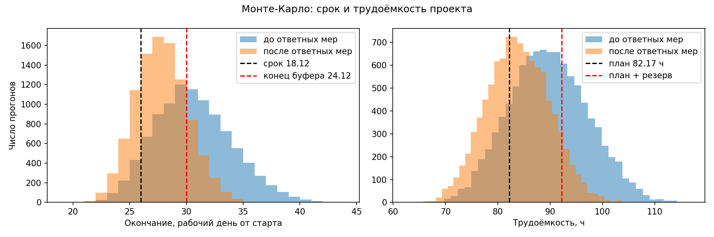

# Реестр рисков

<!-- TODO: шаги 1–3 и 8 задания ЛР 4. Реестр — живой документ: обновляйте его на каждом обзоре спринта. -->

Версия: <...> · Дата: <...> · Владелец реестра: <...>

## 1. Шкалы

| Балл | Вероятность за проект | Влияние на срок | Влияние на бюджет | Влияние на качество | Влияние на ценность для заказчика |
|---|---|---|---|---|---|
| 1 | до 10% | до 1 дня | до 2 ч | Незаметно заказчику | Незаметно |
| 2 | 10–30% | 1–2 дня | 2–5 ч | Мелкий недочёт в одном результате | Одна второстепенная функция теряет смысл |
| 3 | 30–50% | 3–5 дней, в пределах буфера | 5–10 ч | Заметный недочёт, исправляется в следующем спринте | Заказчик сомневается в части продукта |
| 4 | 50–70% | Больше буфера | 10–15 ч, весь резерв | Ошибочный вывод в отчёте | Заказчик может выбрать другое решение для основной задачи |
| 5 | более 70% | Срыв защиты | Больше резерва | Продукт непригоден для заказчика | Продукт не нужен заказчику |

Оценка риска = вероятность × влияние (берётся максимальное из четырёх влияний).
- 15–25 — высокий: ответная мера сейчас, контроль на каждой синхронизации;
- 8–14 — средний: ответная мера в ближайшем спринте, контроль на обзоре;
- 1–7 — низкий: наблюдаем.

## 2. Матрица рисков

<!-- Впишите номера рисков в клетки -->

| Вероятность \ Влияние | 1 | 2 | 3 | 4 | 5 |
|---|---|---|---|---|---|
| **5** | | | | | |
| **4** | | | | | |
| **3** | | | | | |
| **2** | | | | | |
| **1** | | | | | |

## 3. Реестр

| № | Категория (RBS) | Причина → событие → последствие | В | Вл | Оценка | Стратегия | Ответная мера | Триггер | Владелец | Резерв | Статус | Issue |
|---|---|---|---|---|---|---|---|---|---|---|---|---|
| R1 | | Из-за … может произойти …, что приведёт к … | | | | | | | | | | # |

## 4. Возможности

| № | Причина → событие → выгода | В | Вл | Оценка | Стратегия | Мера | Владелец | Issue |
|---|---|---|---|---|---|---|---|---|
| O1 | | | | | | | | # |

## 5. Количественный анализ

### Монте-Карло

Ноутбук: `notebooks/05_risk_monte_carlo.ipynb`. Параметры рисков в модели:

| Риск | Работа | Вероятность до / после мер | Дни до / после | Часы до / после |
|---|---|---|---|---|
| | | | | |

Результаты:

| Сценарий | P(в срок) | P(в буфер) | Срок P50 | Срок P85 | Часы P50 | Часы P85 | P(часы ≤ план + резерв) |
|---|---|---|---|---|---|---|---|
| Только оценки | | | | | | | |
| До ответных мер | | | | | | | |
| После ответных мер | | | | | | | |

Работы, сильнее всего влияющие на срок: <...>

Вывод для спонсора: <...>

### Дерево решений

Риск: <...>

| Вариант | Затраты сейчас | Исходы (вероятность, последствия) | EMV | Ожидаемая задержка | Худший случай |
|---|---|---|---|---|---|
| | | | | | |

Решение и почему: <...>

## 6. Правовые и этические риски

| Вопрос | Что у нас | Что делаем | Где зафиксировано |
|---|---|---|---|
| Лицензии источников данных | DS-01: условия повторной публикации выгрузки ГИБДД не подтверждены. DS-02: ODbL 1.0. DS-03: данные CC BY 4.0, бесплатный API имеет отдельные условия. DS-04: проприетарный API. | Используем DS-01 для расчётов и DS-02 с атрибуцией. DS-03 отложен, DS-04 отклонён. При появлении нового источника проверяем условия до включения в публикуемый слой (R4). | [Карточки источников](../data/sources.md#карточки-источников), [#108](https://github.com/renvoid72/pm-lab-5-CIA/issues/108) |
| Атрибуция на карте и в отчёте | На PNG указаны OSM и ГИБДД. Исходная веб-карта указывала OpenStreetMap для подложки. | На веб-карте и в README указываем оба источника со ссылками. В подписи к карте в отчёте и на демонстрации указываем поставщиков использованных данных. | [README](../README.md#источники-данных), [веб-карта](maps/analysis_v0.html), [PNG](img/accidents_by_district.png) |
| Производная база данных | Слои OSM лежат в `data/processed/`. Пробный GeoJSON совмещает геометрию OSM и показатели ДТП по сегментам. | Для слоёв OSM указываем ODbL и авторство. Условия повторного использования показателей ГИБДД уточняем перед дальнейшей публикацией или передачей смешанного слоя. | [Условия для обработанных данных](../data/sources.md#условия-для-обработанных-данных) |
| Персональные данные | Полные ответы сайта ГИБДД содержат сведения об участниках. CSV и исходный HTML содержат ID, дату, время, координаты и адресные поля ДТП. По сочетанию этих полей отдельный случай можно сопоставить с внешней публикацией. | Исходные файлы храним в закрытой папке команды. В публичный HTML включаем только геометрию районов и сводные показатели. Проверяем поля в исходнике перед публикацией. | [Как получить данные](../data/README.md#как-получить-данные), [ноутбук 03](../notebooks/03_spatial_analysis.ipynb) |
| Смещение данных и справедливость выводов | ГИБДД учитывает в этой выгрузке зарегистрированные ДТП с пострадавшими или погибшими. В пробном расчёте 205 ДТП в границах Уфы остались без привязки к дороге в пределах 50 м. Пробелы в дорожной сети и погрешность координат влияют на сравнение сегментов (R5, R8). | На обзоре и рядом с рейтингом сообщаем заказчику, какие ДТП учтены и сколько осталось без привязки. Рейтинг используем для выявления участков, которые стоит проверить. Охват выгрузки на карте и в материалах демонстрации отражаем в задаче #117. | [Качество данных](data-quality.md), [план коммуникаций](communication-plan.md), [#117](https://github.com/renvoid72/pm-lab-5-CIA/issues/117) |
| Использование ИИ | ИИ помогает с черновиками формулировок и кода. | Команда проверяет условия по первоисточникам, а состав публикуемых полей по HTML. Исходные карточки храним в закрытой папке команды. Использование ИИ фиксируем в журнале. | [Журнал использования ИИ](ai-usage.md) |

## 7. История изменений

| Дата | Что изменилось | Почему |
|---|---|---|
| | | |
