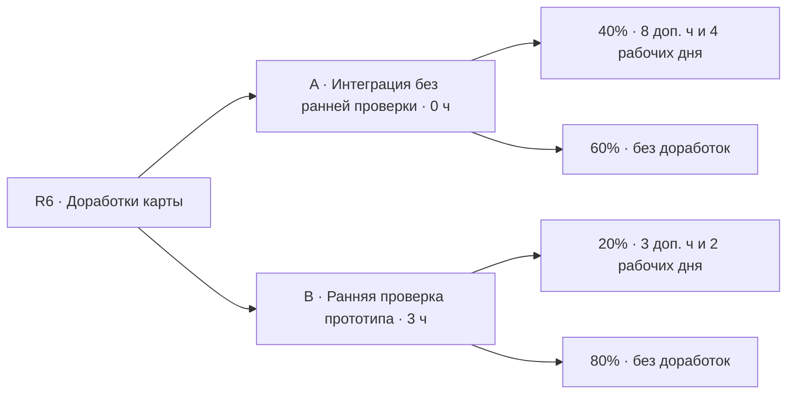

# Реестр рисков

<!-- TODO: шаги 1–3 и 8 задания ЛР 4. Реестр — живой документ: обновляйте его на каждом обзоре спринта. -->

Версия: <...> · Дата: <...> · Владелец реестра: <...>

## 1. Шкалы

| Балл | Вероятность за проект | Влияние на срок | Влияние на бюджет | Влияние на качество | Влияние на ценность для заказчика |
|---|---|---|---|---|---|
| 1 | до 10% | до 1 дня | до 2 ч | Незаметно заказчику | Незаметно |
| 2 | 10–30% | 1–2 дня | 2–5 ч | Мелкий недочёт в одном результате | Одна второстепенная функция теряет смысл |
| 3 | 30–50% | 3–5 дней, в пределах буфера | 5–10 ч | Заметный недочёт, исправляется в следующем спринте | Заказчик сомневается в части продукта |
| 4 | 50–70% | Больше буфера | 10–15 ч, весь резерв | Ошибочный вывод в отчёте | Заказчик может выбрать другое решение для основной задачи |
| 5 | более 70% | Срыв защиты | Больше резерва | Продукт непригоден для заказчика | Продукт не нужен заказчику |

Оценка риска = вероятность × влияние (берётся максимальное из четырёх влияний).
- 15–25 — высокий: ответная мера сейчас, контроль на каждой синхронизации;
- 8–14 — средний: ответная мера в ближайшем спринте, контроль на обзоре;
- 1–7 — низкий: наблюдаем.

## 2. Матрица рисков

<!-- Впишите номера рисков в клетки -->

| Вероятность \ Влияние | 1 | 2 | 3 | 4 | 5 |
|---|---|---|---|---|---|
| **5** | | | | | |
| **4** | | | | | |
| **3** | | | | | |
| **2** | | | | | |
| **1** | | | | | |

## 3. Реестр

| № | Категория (RBS) | Причина → событие → последствие | В | Вл | Оценка | Стратегия | Ответная мера | Триггер | Владелец | Резерв | Статус | Issue |
|---|---|---|---|---|---|---|---|---|---|---|---|---|
| R1 | | Из-за … может произойти …, что приведёт к … | | | | | | | | | | # |

## 4. Возможности

| № | Причина → событие → выгода | В | Вл | Оценка | Стратегия | Мера | Владелец | Issue |
|---|---|---|---|---|---|---|---|---|
| O1 | | | | | | | | # |

## 5. Количественный анализ

### Монте-Карло

[Ноутбук 05](../notebooks/05_risk_monte_carlo.ipynb) моделирует 10 000 прогонов для каждого из трёх сценариев. Длительности, зависимости и очередность работ у исполнителей взяты из [декабрьского графика](schedule.md#2-сетевой-график). Оценки O, M и P сокращённых и разделённых пакетов масштабированы до их плановой трудоёмкости. Вероятности и дополнительные дни и часы заданы экспертно. Для сравнения часов использованы 82,17 ч на пакеты работ и 10 ч резерва из [бюджета](budget.md#1-бюджет-по-статьям). Управленческие часы учитываются отдельно.

| Риск | Работа | Вероятность до / после мер | Дни до / после | Часы до / после |
|---|---|---|---|---|
| R2 · Снижение доступности участника | 2.1 | 20% / 20% | 5 / 2 | 2 / 2 |
| R3 · Запрос дополнительных функций | 3.1b | 40% / 20% | 3 / 2 | 4 / 2 |
| R5 · Ошибочная привязка ДТП к дороге | 2.1 | 20% / 10% | 2 / 1 | 4 / 2 |
| R6 · Доработки карты перед приёмкой | 3.1b | 40% / 20% | 4 / 2 | 8 / 3 |
| R8 · Неверная трактовка охвата выгрузки | 5.2 | 80% / 20% | 1 / 1 | 2 / 1 |

| Сценарий | К 18.12.2026 (план) | К 24.12.2026 (конец буфера) | К 26.12.2026 (сдача) | Срок P50 | Срок P85 | Часы P50 | Часы P85 | P(часы ≤ 82,17) | P(часы ≤ 92,17) |
|---|---:|---:|---:|---|---|---:|---:|---:|---:|
| Только оценки | 34,28% | 92,60% | 97,37% | 21.12.2026 | 24.12.2026 | 82,10 | 88,30 | 50,36% | 95,89% |
| До ответных мер | 7,86% | 45,64% | 57,17% | 25.12.2026 | 11.01.2027 | 89,48 | 97,71 | 16,50% | 63,37% |
| После ответных мер | 22,02% | 82,81% | 91,20% | 22.12.2026 | 25.12.2026 | 83,75 | 90,23 | 39,65% | 91,49% |

**Чувствительность срока до ответных мер.** Три работы с наибольшей ранговой корреляцией длительности со сроком проекта:

| Работа | Корреляция Спирмена | Индекс критичности |
|---|---:|---:|
| 3.1b · Интеграция карты и данных | 0,63 | 74,23% |
| 2.1 · Показатели по участкам | 0,56 | 59,25% |
| 5.2 · Публикация карты | 0,17 | 82,98% |

Наибольшая разница среднего срока между прогонами с наступившим риском и без него в сценарии до мер наблюдается у R2 (+3,91 рабочего дня), R6 (+3,21) и R3 (+2,40). Итоговые материалы (6.3b) входят в критический путь в 100% прогонов.

**Вывод для спонсора.** Если выполнить ответные меры, модель даёт 82,81% вероятности закончить к концу буфера 24 декабря, 91,20% — к сдаче 26 декабря и 91,49% — уложиться в 92,17 ч с резервом, а наиболее заметные угрозы сроку связаны с доступностью участника, доработками карты и дополнительными требованиями.

### Дерево решений

Для **R6** сравниваем интеграцию сразу и раннюю проверку прототипа карты. Дополнительные дни в дереве относятся к работе 3.1b. Влияние на дату сдачи оценивается по сетевой модели выше.

| Вариант | Затраты сейчас | Исходы (вероятность, последствия) | EMV | Ожидаемая задержка | Худший случай |
|---|---|---|---|---|---|
| A · Интеграция без ранней проверки | 0 ч | 40% · 8 ч и 4 дня, 60% · без доработок | 3,20 ч (1 280 руб.) | 1,60 дня | 8 ч и 4 дня |
| B · Ранняя проверка прототипа | 3 ч | 20% · ещё 3 ч и 2 дня, 80% · без доработок | 3,60 ч (1 440 руб.) | 0,40 дня | 6 ч с проверкой и 2 дня задержки |

**Решение — вариант B.** Ожидаемые затраты растут на 0,40 ч, а ожидаемая задержка сокращается на 1,20 рабочего дня. Для проверки используем спайк на 3 ч, уже заложенный в пакет 3.1. Замеряем скорость загрузки прототипа перед интеграцией и при превышении порога 3 с определяем, какой слой оптимизировать первым. Вероятность уложиться в буфер после мер выше порога 80%. Сохраняем сроки и резерв при условии ранней проверки карты, подготовки дублёра по критическим работам и согласования новых требований перед включением в релиз. [Лимиты спайков](estimation.md#спайки-ограничение-по-времени)

## 6. Правовые и этические риски

| Вопрос | Что у нас | Что делаем | Где зафиксировано |
|---|---|---|---|
| Лицензии источников данных | | | |
| Атрибуция на карте и в отчёте | | | |
| Производная база данных | | | |
| Персональные данные | | | |
| Смещение данных и справедливость выводов | | | |
| Использование ИИ | | | |

## 7. История изменений

| Дата | Что изменилось | Почему |
|---|---|---|
| | | |
