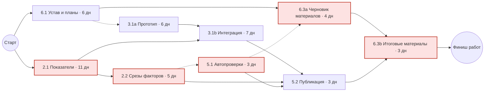
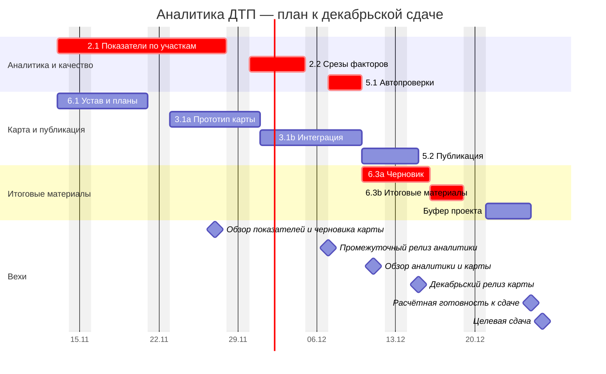

# Календарный план и ресурсы

Базовый план, версия <1.0>, утверждён <дата>. Изменения после утверждения — только через запрос на изменение.

## 1. Доступное время

- Расчётный старт работ — 13.11.2026. Целевая сдача — 26.12.2026, ориентир по графику занятий. До неё 31 рабочий день, включая день старта и 25 декабря.
- Плановая загрузка — 10,5 ч в неделю на человека, из них 1 ч на управление (WBS 6.2). На пакеты приходится 1,9 ч на человека в рабочий день, или 117,8 ч на двоих за 31 день. Управление за это окно — 12,4 ч на двоих пропорционально числу рабочих дней.
- 13 ноября — дата отсчёта для плана. Фактическую готовность работ и доступность обоих участников сверяем в #84.

## 2. Сетевой график

**Решение по сроку.** Исходный объём без экспорта оценён по [PERT](estimation.md) в 98,67 ч. Последовательный график при 6 ч в неделю на человека занимал 85 рабочих дней. Для декабрьской сдачи планируем 10,5 ч в неделю на человека, делим карту и итоговые материалы на две части и ограничиваем объём работ:

- **2.2, 8 ч.** Рассчитываем по участкам описательные срезы по погоде, освещению, времени и состоянию покрытия для карточек карты. Отдельную модель факторов выносим на следующие итерации. Результат не интерпретируем как причинное влияние.
- **3.1, 22 ч.** Используем HTML-карту ЛР 2 как заготовку. Сначала готовим интерфейс (3.1a, 10 ч), затем подключаем результаты по участкам, фильтры и статистику (3.1b, 12 ч).
- **6.3, 10,5 ч.** Готовим черновик итоговых материалов заранее (6.3a, 6,5 ч), после публикации добавляем фактические результаты и ссылки (6.3b, 4 ч).
- **4.1, экспорт.** Планируется за пределами декабрьской сдачи после решения заказчика по Q1. Изменения объёма на декабрь нужно согласовать с заказчиком. Оценки PERT в `estimation.md` сохраняются как исходные.

Длительность каждого пакета округлена вверх из расчёта 1,9 ч/день на исполнителя. Сплошные стрелки обозначают зависимости по результатам работ, пунктир между работами — очередность у одного исполнителя. Отсчёт начинается с рабочего дня 0.

| Работа | Исполнитель | Часы | Длит., дн | Предшественники | ES | EF | LS | LF | Резерв |
|---|---|---:|---:|---|---:|---:|---:|---:|---:|
| **2.1** | Ковальчук | 20,67 | 11 | — | 0 | 11 | 0 | 11 | **0** |
| **2.2** | Ковальчук | 8 | 5 | 2.1 | 11 | 16 | 11 | 16 | **0** |
| **5.1** | Ковальчук | 5,50 | 3 | 2.2 | 16 | 19 | 16 | 19 | **0** |
| 6.1 | Рязанов | 10,17 | 6 | — | 0 | 6 | 1 | 7 | 1 |
| 3.1a | Рязанов | 10 | 6 | 6.1 | 6 | 12 | 7 | 13 | 1 |
| 3.1b | Рязанов | 12 | 7 | 3.1a, 2.1 | 12 | 19 | 13 | 20 | 1 |
| 5.2 | Рязанов | 5,33 | 3 | 3.1b, 2.2, 5.1 | 19 | 22 | 20 | 23 | 1 |
| **6.3a** | Ковальчук | 6,50 | 4 | 6.1, 5.1 | 19 | 23 | 19 | 23 | **0** |
| **6.3b** | Ковальчук | 4 | 3 | 5.2, 6.3a | 23 | 26 | 23 | 26 | **0** |

**Критический путь с учётом очередности у исполнителей — 2.1 → 2.2 → 5.1 → 6.3a → 6.3b, 26 рабочих дней.** Плановые трудозатраты — 82,17 ч (44,67 ч у Ковальчука и 37,50 ч у Рязанова). Работы с буфером занимают 30 из 31 рабочего дня. Для старта нужны данные ЛР 2 и доступ к выгрузке ГИБДД. Для публикации нужны готовые срезы факторов, пройденные автопроверки и доступ к GitHub Pages.

## 3. Диаграмма Ганта

**Буфер — 4 рабочих дня.** Для исходной оценки PERT без экспорта разница между уровнем 85% и ожидаемой трудоёмкостью составляет около 7,01 ч. Используем её как ориентир резерва для сокращённого сценария. При 1,9 ч/день на критической цепочке округляем вверх до 4 дней и ставим весь буфер после итоговых материалов.

На обзоре 27.11 планируем показать показатели и черновик карты, на обзоре 11.12 — срезы факторов и карту с подключёнными данными. Расчётный релиз карты — 15.12. Последний день работы над итоговыми материалами — 18.12. Буфер занимает 21–24.12. Расчётная готовность к сдаче — к началу 25.12, этот рабочий день остаётся свободным. Даты релизов и цели спринтов уточняются в #85.

## 4. Ресурсы

На каждого участника запланировано 10,5 ч в неделю, из них 1 ч на управление. Ёмкость на пакеты работ составляет 9,5 ч в неделю или 19 ч за двухнедельный спринт. На 25.12 приходится ещё 1,9 ч на человека, этот день оставлен свободным перед сдачей. Известные отсутствия в расчёт пока не заложены, доступность нужно подтвердить вдвоём.

В матрицах указаны часы на пакеты работ и доля от ёмкости спринта. Для пакетов на стыке спринтов часы распределены пропорционально рабочим дням по графику. Буфер 21–24.12 сохраняется перед сдачей.

### Матрица загрузки до выравнивания

| Участник | Sprint 1 · 13–26.11 | Sprint 2 · 27.11–10.12 | Sprint 3 · 11–24.12 |
|---|---:|---:|---:|
| Ковальчук | **28,95 ч (152%)** | 11,50 ч (61%) | 8,88 ч (47%) |
| Рязанов | 6,67 ч (35%) | **22,61 ч (119%)** | 3,56 ч (19%) |

В расчёте до выравнивания применены исходные назначения из WBS к тем же календарным интервалам. Перегрузка возникает у Ковальчука в первом спринте и у Рязанова во втором.

### Решения по выравниванию

1. Передать пакет 6.1 «Устав и планы» от Ковальчука Рязанову, чтобы освободить время Ковальчука для расчёта показателей в первом спринте.
2. Передать пакет 5.1 «Окружение и автопроверки» от Рязанова Ковальчуку, чтобы освободить время Рязанова на интеграцию и публикацию карты во втором спринте.
3. Использовать назначения из сетевого графика при заполнении ответственных в задачах на доске. При подтверждённом отсутствии участника пересчитать его ёмкость, особенно в первом спринте.

### Матрица загрузки после выравнивания

| Участник | Sprint 1 · 13–26.11 | Sprint 2 · 27.11–10.12 | Sprint 3 · 11–24.12 | Всего |
|---|---:|---:|---:|---:|
| Ковальчук | 18,79 ч (99%) | 17,00 ч (89%) | 8,88 ч (47%) | 44,67 ч |
| Рязанов | 16,83 ч (89%) | 17,11 ч (90%) | 3,56 ч (19%) | 37,50 ч |

Итого на пакеты назначено 82,17 ч. Наибольшая загрузка — 99% у Ковальчука в первом спринте. Управленческая работа учитывается отдельно, 12,4 ч на двоих за 31 рабочий день.

## 5. Релизный план

| Спринт | Даты | Цель спринта | Истории (SP) | Пакеты WBS | Релиз |
|---|---|---|---|---|---|
| | | | | | |

Гипотеза скорости: <...> SP за спринт. Что переносим, если скорость не подтвердится: <...>

Roadmap на доске: <ссылка на представление>
