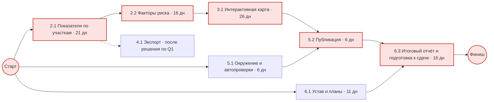

# Календарный план и ресурсы


Базовый план, версия <1.0>, утверждён <дата>. Изменения после утверждения — только через запрос на изменение.

## 1. Доступное время

- Плановое окно для сравнения с сетевым графиком — с 16.11.2026 по 26.12.2026. В нём 30 будних дней, с 16 ноября по 25 декабря включительно.
- Работы планируются на будни. Субботы используются как ориентиры для сверки с графиком занятий.
- 28.11 и 12.12 — возможные контрольные точки по двухнедельному ритму занятий. 26.12 — плановая итоговая сдача, дата принята для расчёта.

## 2. Сетевой график

Длительности рассчитаны по ожидаемым трудозатратам из [оценки PERT](estimation.md#2-трёхточечная-оценка-пакетов-работ-pert). На каждого участника приходится 6 ч в неделю, из них 1 ч отведён на управление (WBS 6.2). При пятидневной неделе это даёт в среднем 1 ч на работу по пакетам в день. Для каждого пакета принят один исполнитель, а дробная длительность округлена вверх. Отсчёт рабочих дней начинается с 0.



| Работа | Длит., дн | Предшественники | ES | EF | LS | LF | Резерв |
|---|---|---|---|---|---|---|---|
| **2.1** | 21 | — | 0 | 21 | 0 | 21 | **0** |
| **2.2** | 16 | 2.1 | 21 | 37 | 21 | 37 | **0** |
| **3.1** | 26 | 2.2 | 37 | 63 | 37 | 63 | **0** |
| 5.1 | 6 | — | 0 | 6 | 57 | 63 | 57 |
| **5.2** | 6 | 3.1, 5.1 | 63 | 69 | 63 | 69 | **0** |
| 6.1 | 11 | — | 0 | 11 | 58 | 69 | 58 |
| **6.3** | 16 | 5.2, 6.1 | 69 | 85 | 69 | 85 | **0** |

**Критический путь — 2.1 → 2.2 → 3.1 → 5.2 → 6.3. Длина — 85 рабочих дней.**

Для старта нужны подготовленные данные ЛР 2 и доступ к выгрузке ГИБДД. Для публикации нужны доступ к GitHub Pages и пройденные автопроверки. Длительность 6.3 взята из PERT как оценка подготовки итоговых материалов и сдачи. Экспорт 4.1 показан пунктиром как условная ветка после расчёта показателей и решения заказчика по Q1. Срок до итоговой сдачи рассчитан без экспорта.

До итоговой сдачи есть шесть рабочих недель. Доступность команды составляет 2 участника × 6 ч/нед. × 6 недель = 72 ч. Управление занимает 2 × 1 × 6 = 12 ч, на пакеты работ остаётся 60 ч. По PERT на работы до сдачи требуется 98,67 ч без экспорта, поэтому дефицит составляет 38,67 ч. Критический путь превышает окно в 30 рабочих дней на 55 дней при текущих зависимостях и загрузке.

К ближайшей контрольной точке сначала планируем выбрать метод выделения опасных участков и получить первые показатели на готовой выгрузке. Для итоговой сдачи в #83 нужно определить обязательный объём и сверить его с доступным временем. В #84 проверим загрузку участников и какие части расчёта, карты и итоговых материалов можно делать параллельно.

## 3. Диаграмма Ганта

```mermaid
gantt
    title <Проект>: базовый календарный план
    dateFormat YYYY-MM-DD
    axisFormat %d.%m
    excludes weekends
    section Спринт 1
    <работа> :crit, a, <дата>, <N>d
    Буфер проекта :buf, after a, <N>d
    Защита :milestone, m, <дата>, 0d
```

Буфер: <N> дней. Как рассчитан: <...>

## 4. Ресурсы

Ёмкость на продукт: <ч в неделю> на человека, <ч> за двухнедельный спринт. Отсутствия: <...>

### Матрица загрузки до выравнивания

| Участник | Sprint 1 | Sprint 2 | Sprint 3 | Sprint 4 |
|---|---|---|---|---|
| | | | | |

### Решения по выравниванию

1. <...>

### Матрица загрузки после выравнивания

| Участник | Sprint 1 | Sprint 2 | Sprint 3 | Sprint 4 | Всего |
|---|---|---|---|---|---|
| | | | | | |

## 5. Релизный план

| Спринт | Даты | Цель спринта | Истории (SP) | Пакеты WBS | Релиз |
|---|---|---|---|---|---|
| | | | | | |

Гипотеза скорости: <...> SP за спринт. Что переносим, если скорость не подтвердится: <...>

Roadmap на доске: <ссылка на представление>
