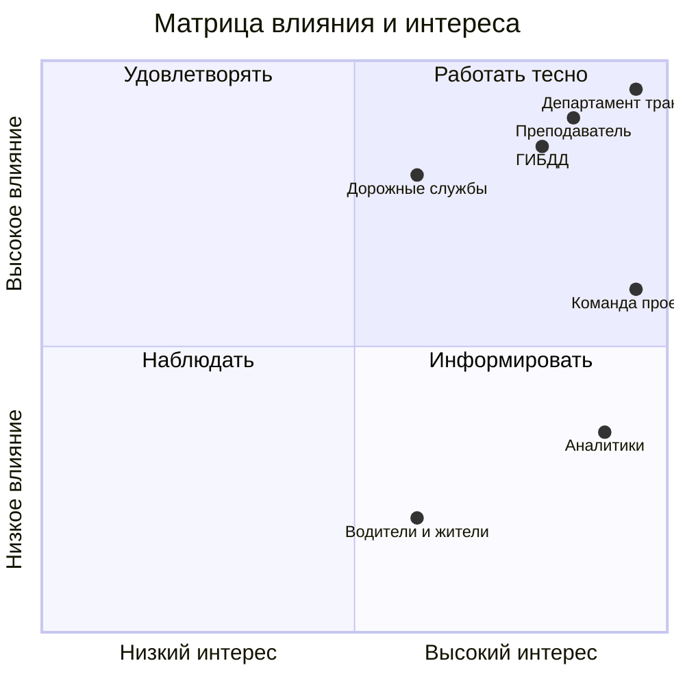

# Стейкхолдеры, матрица влияния и интереса, RACI

<!-- Шаг 4 задания ЛР 1. -->

## Реестр

| Стейкхолдер | Роль | Что ожидает | Влияние (1–5) | Интерес (1–5) | Как работаем |
|---|---|---|---|---|---|
| Департамент транспорта | Заказчик | Обоснование, где ремонтировать в первую очередь | 5 | 5 | Еженедельный статус |
| ГИБДД | Ключевой пользователь | Данные для расстановки постов и камер | 4 | 4 | Встречи раз в две недели |
| Аналитики дорожной безопасности | Пользователи | Быстрые отчёты по участкам, карта | 2 | 5 | Тестируем на небольшой группе |
| Дорожные службы | Потребитель результатов | Список участков для ремонта | 4 | 3 | Информируем, согласуем приоритеты |
| Водители и жители города | Косвенные пользователи | Безопасные дороги, меньше аварий | 1 | 3 | Не взаимодействуем напрямую |
| Преподаватель | Куратор | Соответствие требованиям курса | 5 | 4 | Плотно, на каждой контрольной точке |
| Команда проекта | Исполнители | Понятные задачи, сроки, роли | 3 | 5 | Ежедневно в чате, встречи по субботам |

## Матрица влияния и интереса

## RACI

| Работа | Менеджер проекта | Аналитик | Тех. организатор | Заказчик |
|---|---|---|---|---|
| Устав проекта | A/R | C | I | C |
| Бизнес-обоснование | A | R | I | C |
| Реестр стейкхолдеров | A | R | I | C |
| Цели SMART | R | C | C | A |
| Реестр рисков | A | C | R | I |
| Выбор подхода (ADR) | A | C | R | I |
| Настройка репозитория и доски | A | I | R | I |
| Сбор данных о ДТП | A | R | C | I |
| Отчёты для ремонта | R | A | C | C |

## Интервью с заказчиком
Протокол: [docs/meetings/](meetings/)
